# The gitcalculator

**The face-selection law as a calculator** · computed by the backend, certified
against the theorem, attacked by the counter-arguments, pinned to git.

[**Quick start →**](#quick-start) · [Seven modes](#seven-questions-one-law) · [Reading a receipt](#reading-a-receipt) · [The exact certificate](#the-exact-certificate) · [Certified measurement](#certified-measurement) · [Counter-arguments](#counter-arguments) · [Design, Sweep, Map, Attack](#design-sweep-map-and-attack) · [History](#history-answers-have-commits) · [Conjectures](#conjectures) · [The tape](#the-tape) · [Web calculator](#the-web-calculator) · [Scope](#scope-and-limits)

| 01 · Theorem | 02 · Backend | 03 · Counter-arguments | 04 · Git |
| :--- | :--- | :--- | :--- |
| [Polyhedral selection law](FORMAL_FACE_SELECTION.md) | [Backend contract](FACE_SELECTION_BACKEND.md) | [Mathematical audit](MATHEMATICAL_AUDIT.md) | Blob ids, code states, history |

The repository holds three things about one result: the mathematics that states
the law, the backend that executes it, and the counter-arguments that bound it.
The gitcalculator puts them on one receipt. For a polyhedron $P$, a base
objective $F$ and a perturbation $G$ it returns the response exponent

$$
\Delta(s)=M(s)-F(v)-sG(v)=\Theta\left(s^{\gamma}\right),\qquad
\gamma=\frac{1}{1-q_\ast},
$$

together with the evidence for each step:

1. **Compute.** The public backend runs unchanged
   (`categorical_polytope.adjudication.polyhedra.backend`).
2. **Certify.** An independent checker re-derives the local model from the
   request alone and discharges the theorem's hypotheses in exact rational
   arithmetic wherever it can.
3. **Attack.** Thirteen counter-arguments from the repository's own audit and
   revision records are applied to the input. A separate measurement computes
   certified lower bounds on $\Delta(s)$ that can contradict a prediction.
4. **Pin.** Every source file and cited document is identified by its git blob
   id. The same input can be replayed against every code state in the
   repository's history.

```mermaid
flowchart LR
  accTitle: One calculation, four columns
  accDescr: A request goes to the backend, then to the exact certificate, the counter-arguments and the certified measurement. Git provenance pins all of them, and a history replay asks every earlier code state the same question.
  request("Request<br/>P, F, G")
  backend("Backend<br/>face selection")
  certificate("Exact certificate<br/>H0 to H5")
  counter("Counter-arguments<br/>and certified bounds")
  receipt("Receipt<br/>content-addressed")
  history("History<br/>every code state")
  request --> backend --> certificate --> counter --> receipt
  receipt --> history
  classDef input fill:#102734,stroke:#8199a4,color:#edf2f4
  classDef work fill:#173b46,stroke:#87b8bd,color:#edf2f4
  classDef result fill:#283b3b,stroke:#d9b77b,stroke-width:2px,color:#fff1d6
  class request input
  class backend,certificate,counter work
  class receipt,history result
  linkStyle default stroke:#9b875f,stroke-width:2px
```

## Seven questions, one law

Because the law maps geometry to an exponent exactly, the calculator runs it in
seven directions.

| Mode | The question it answers | Command |
| :--- | :--- | :--- |
| **Solve** | What is $\gamma$ for this $P$, $F$, $G$, and is it a theorem? | `calc` |
| **Design** | Which exponents can this vertex produce at all, and which $G$ reaches a target $\gamma$? | `design` |
| **Sweep** | Where does $\gamma$ change along a family $G_t$, exactly? | `sweep` |
| **Map** | Which chambers does a two-parameter family $G_{t,u}$ fall into, and where are the walls? | `map` |
| **Attack** | Which nearby inputs break this answer? | `attack` |
| **History** | What did every version of the code answer, and was it right? | `history` |
| **Conjecture** | Does a candidate law survive everything the calculator can certify? | `conjecture` |

Every mode runs in two independent implementations: the Python package, and an
exact JavaScript engine that runs in the browser. A regression test checks that
they agree.



---

## Quick start

Run from the repository root with Python 3.10 or newer. The calculator uses the
standard library and the local package only.

```bash
python -m gitcalculator calc --preset tilted-simplex
```

The printed receipt opens with the verdict:

```text
ANSWER    PROVED   Δ(s) = Θ(s^4/3)
          γ = 4/3   q* = 1/4   C = 0.47247 (backend, measured)
          Every hypothesis of the theorem is discharged in exact arithmetic.
```

Any input works the same way:

```bash
python -m gitcalculator calc --system "([[-1,0],[0,-1],[1,1]], [0,0,1])" --base "-((x0+x1-1)**2 + x0**4)" --perturbation "x0"
```

| Command | What it does |
| :--- | :--- |
| `calc` | One receipt; `--json` for the full record, `--markdown` for a proof sheet, `--history` to add the replay, `--observed 4/3` for the inverse check |
| `design` | The exponent spectrum of the vertex; `--target 3/2` synthesizes and certifies perturbations for one exponent |
| `sweep` | The exact phase fan of a family written with the parameter `t`, over `--from` and `--to` |
| `map` | The phase map of a family written with `t` and `u`: one exact certificate per cell, and each coefficient as a polynomial $a(t,u)$ |
| `attack` | Generated counterexamples: every mutation of the input, re-certified |
| `presets` | The thirteen canonical calculations |
| `counter` | Every counter-argument with its claim, refutation and executable witness; exits nonzero if a witness fails |
| `history` | Replays one input across every code state in git |
| `conjecture test` / `record` / `verify` | Tests a candidate law on the presets or a family, records it in [`conjectures/`](../conjectures/), and rechecks every recorded verdict |
| `tape record` / `tape verify` | Records calculations in [`calculations/`](../calculations/) and checks them for drift |
| `site --out DIR` | Builds the static web calculator |
| `visit URL` | Loads a published calculator the way a browser does and checks every file against git |

After `python -m pip install -e .` the same commands are available as
`gitcalculator`.

## Reading a receipt

The verdict combines all four columns.

| Verdict | Meaning |
| :--- | :--- |
| `proved` | Every hypothesis of the polyhedral theorem is discharged in exact arithmetic, or Lemma 2 proves $\Delta(s)=0$ for small $s$ |
| `proved-v22` | The separately scoped curved-reduction theorem [V.22](FORMAL_CURVED_REDUCTION.md) applies, with its own exact checks |
| `licensed` | The backend licenses the answer, but at least one hypothesis rests on a numerical probe or fails the exact check |
| `unlicensed` | An exponent was computed, but a hypothesis fails or is unresolved |
| `refused` | The input lies outside the law as stated |
| `contradicted` | Certified lower bounds outgrow a licensed exponent: a candidate counterexample to the backend |

Each theorem step is printed as a row of the **theorem ledger**: the clause
and its document anchor, what the backend computed for it, the exact
certificate, and the counter-arguments aimed at that step. A link has one of
these statuses.

| Status | Meaning |
| :--- | :--- |
| `exact` | Proved here with rational arithmetic |
| `probed` | Supported only by the backend's finite numerical probe |
| `failed` | Shown false, exactly |
| `unresolved` | The sufficient exact test does not decide it |
| `not_reached` | An earlier link failed, so the premise is missing |

The receipt id is a content address: a SHA-256 over the input, the code state,
the calculator's own code, and the discrete outcome. The same calculation on
the same code always prints the same id.

## The exact certificate

[`certify.py`](../gitcalculator/certify.py) checks each link of
[the polyhedral theorem](FORMAL_FACE_SELECTION.md) for polynomial $F$ and $G$.
It shares no numerics with the backend's predictor.

| Link | Exact method |
| :--- | :--- |
| [Standing assumptions](FORMAL_FACE_SELECTION.md#0-standing-assumptions) | Boundedness by an exact Fourier–Motzkin recession test; full dimension by an explicit interior point; polynomial degree from the syntax tree |
| [Simple vertex](FORMAL_FACE_SELECTION.md#1-setup) | Exact vertex enumeration; exactly $n$ active constraints; $A_Sv=b_S$ and $A_Su_i=-e_i$ verified |
| [Transport, V.20](FORMAL_AMBIENT_FACE_TRANSPORT.md#statement) | The repository's compiler, then a proof of the pullback identity by exact agreement on a $(d+1)^n$ product grid |
| [Hypothesis 0](FORMAL_FACE_SELECTION.md#2-global-isolation) | A nonnegative base loss with positive pure edge terms, or a concavity certificate together with strict local maximality |
| [Hypotheses 1 and 2](FORMAL_FACE_SELECTION.md#4-hypotheses-with-uniform-remainders) | The weighted Newton data of $D$: every monomial other than the diagonal principal part must have weighted degree above one |
| [Faces](FORMAL_FACE_SELECTION.md#5-faces-and-admissibility-defined-from-the-data-alone) | Exact restriction, first nonzero layer, and a rational relative-interior witness |
| [Hypothesis 5](FORMAL_FACE_SELECTION.md#6-upper-control-on-unqualified-faces) | Monomial domination and absorption, a sufficient test |

The envelope test needs one line of algebra. A positive monomial whose weighted
degree is at least the cutoff is bounded by the base on the compact normalized
section. A positive monomial below the cutoff is absorbed when a negative
monomial $N$ divides it componentwise:

$$
-bN+aNm=-N\left(b-am\right)\le0\quad\text{near the vertex, because }m\to0.
$$

When every positive monomial is controlled, $R_+\le KD_0^{q_\ast}$ holds near
the vertex. With no qualified face, the same test with cutoff one proves
$\Delta(s)=0$ for small $s$ by Lemma 2.

The certificate also compares its exact $q_\ast$ and minimal winning faces with
the backend's selection.

## Certified measurement

[`measure.py`](../gitcalculator/measure.py) supplies evidence that does not
depend on the theory. For a sequence of perturbation sizes $s$, a search in
logarithmic edge coordinates proposes a point $c$. The point is rounded to
twelve significant digits, mapped to $x=\Phi(c)$, and verified to lie in $P$.
Then

$$
L(s)=F(x)-F(v)+s\left(G(x)-G(v)\right)
$$

is evaluated exactly from the user's expressions. Every printed value is a
proved inequality $\Delta(s)\ge L(s)$, rounded down, and the receipt's own
decimals reproduce it.

The search follows the optimizer path by geometric extrapolation: optimal
coordinates follow power laws in $s$, so a narrow curved ridge such as
$x=y^2/2$ stays inside the search. Each available prediction is then judged.

- **consistent:** the local log–log slopes approach the predicted $\gamma$.
- **contradicted:** the slopes stay below $\gamma$ and $L(s)/s^{\gamma}$ rises
  monotonically. Certified gains outgrow the predicted order at the tested
  scales.
- **inconclusive:** neither holds. Bounds that fall short of a prediction can
  mean only that the search missed the optimum.

A finite sequence of scales cannot disprove an asymptotic statement. A
contradiction is certified evidence at the tested scales, and it is reported as
exactly that.

## Counter-arguments

[`counter.py`](../gitcalculator/counter.py) turns the repository's refuted claims
into checks. Each entry carries the refuted claim, the counterexample as the
documents state it, an executable witness with the outcome the current code
must produce, and an assessment of how it bears on your input: `blocks`,
`caveat`, `averted` or `clear`.

| Id | Refuted claim | Source |
| :--- | :--- | :--- |
| `ambient-axes` | Ambient axes decide the exponent | [V.20](FORMAL_AMBIENT_FACE_TRANSPORT.md#why-ambient-axes-fail) |
| `signed-channel` | A non-positive initial form excludes gain | [Audit §1](MATHEMATICAL_AUDIT.md#1-an-exact-counterexample-with-a-sharp-constant) |
| `signed-sharp` | A qualified face fixes the exponent despite signed terms below it | [Audit §1](MATHEMATICAL_AUDIT.md#1-an-exact-counterexample-with-a-sharp-constant) |
| `interior-zero` | Negative axis forms rule out gain | [Audit §2](MATHEMATICAL_AUDIT.md#2-why-uniform-remainders-did-not-repair-the-proof) |
| `empty-not-zero` | No qualified face means no response | [Scope](FORMAL_FACE_SELECTION.md#10-scope) |
| `active-set` | The winning face is the optimizer's support | [Audit §6](MATHEMATICAL_AUDIT.md#6-exponent-selection-does-not-fix-the-active-set) |
| `homogeneity-probe` | A measured homogeneity near one proves the principal part | [Hypotheses](FORMAL_FACE_SELECTION.md#4-hypotheses-with-uniform-remainders) |
| `isolation-probe` | Finding no rival maximizer proves uniqueness | [Isolation](FORMAL_FACE_SELECTION.md#2-global-isolation) |
| `critical-layer` | Degree-one terms obey the same law | [Term classes](FACE_SELECTION_BACKEND.md#term-level-perturbation-classification) |
| `tied-coefficient` | One tied monomial determines the coefficient | [Revision record](PRINCIPLE_DOCUMENTATION_REVIEW.md#substantive-corrections-and-clarifications) |
| `finite-scale` | The asymptotic law gives the response at a given $s$ | [Finite scale](CURVED_FINITE_SCALE.md) |
| `inverse-tolerance` | Inverse matching identifies the mechanism exactly | [Inverse](FACE_SELECTION_BACKEND.md#forward-and-inverse-power) |
| `non-simple` | The law applies at any vertex | [Scope](FORMAL_FACE_SELECTION.md#10-scope) |

`python -m gitcalculator counter` runs all thirteen witnesses. A regression
test also checks that every cited file and heading exists.

Two calculations show what the combination adds.

- **The ambient-axis answer is contradicted.** On the tilted simplex the
  ambient axes predict $\gamma=2$. The certified bounds follow
  $s^{4/3}$, with $L(s)/s^{4/3}$ agreeing with the exact coefficient
  $3\cdot4^{-4/3}$ to eleven significant digits, and contradict the exponent $2$.
- **A licensed answer can rest on a false hypothesis.** For
  $F=-(x_0^2+x_0x_1+x_1^2)$ on the unit square the backend measures a
  homogeneity of $1.0$ and licenses $\gamma=2$. The cross term $x_0x_1$ has the
  principal weight, so the diagonal principal part of Hypothesis 2 fails
  exactly. The exponent agrees with the measurement, but the theorem as stated
  does not deliver it. The receipt reports `licensed`, not `proved`.

## Design, Sweep, Map and Attack

[`modes.py`](../gitcalculator/modes.py) and its browser twin
[`modes.js`](../gitcalculator/web/modes.js) run the certificate in three new
directions.

### Design: the exponent spectrum of a vertex

At a simple vertex the edge coordinates are the slacks of the active
constraints, because $A_Su_i=-e_i$ gives

$$
c=b_S-A_Sx.
$$

A monomial $c^\alpha$ is therefore the perturbation
$\prod_i(b_{S_i}-a_{S_i}\cdot x)^{\alpha_i}$, with weighted degree
$q=\sum_i\alpha_i/\beta_i$. Every exponent the qualified-face law or a V.22
channel can produce at the vertex lies in the discrete set

$$
\Gamma_v=\lbrace\frac{1}{1-q}:q=\sum_i\frac{\alpha_i}{\beta_i},\
\alpha\in\mathbb N^n\setminus\lbrace0\rbrace,\ 0\lt q\lt1\rbrace .
$$

The calculator enumerates $\Gamma_v$, writes one perturbation for each exponent
in ambient coordinates, and certifies it. At the tilted simplex the edge orders
are $(4,2)$, so

$$
\Gamma_v=\lbrace\tfrac43,\ 2,\ 4\rbrace,
$$

reached by $G=x_0$, $G=1-x_0-x_1$ and $G=x_0(1-x_0-x_1)$. A target outside
$\Gamma_v$ is reported as unreachable, with its nearest neighbours: no
polynomial perturbation produces $\gamma=3/2$ at that vertex under the
theorem's hypotheses. On the unit square with orders $(4,6)$ the spectrum has
ten exponents, from $6/5$ to $12$.

```bash
python -m gitcalculator design --preset tilted-simplex --target 3/2
```

### Sweep: the phase fan, compiled

For a family $G_t$ the transported coefficients are polynomials in $t$. The
sweep interpolates them exactly, takes their real roots as coefficient walls
(exact when rational), and certifies sample points in every chamber. When two
samples in one chamber disagree, it bisects on the certified outcome and
reports a bracket whose two ends are both certified. That finds walls no
coefficient predicts. For $D_0=x^4+y^4$ and
$G_t=-x^2+t\,xy-y^2$, every coefficient is constant for $t\gt0$, yet the
outcome changes at $t=2$, where $-x^2+t\,xy-y^2$ first becomes positive inside
the cone. The [V.18 qualification example](FORMAL_QUALIFIED_SELECTION_STRATIFICATION.md)
appears as an exact wall at $t=1/3$.

```bash
python -m gitcalculator sweep --system "([[-1,0],[0,-1],[1,0],[0,1]], [0,0,1,1])" --base "-(x0**4+x1**4)" --perturbation "-x0**2 + t*x0*x1 - x1**2" --from 0 --to 4
```

### Map: the phase diagram in two parameters

A family $G_{t,u}$ with two parameters has a phase diagram rather than a phase
strip. The map certifies one rational point at the centre of every cell, in
exact arithmetic. It then names each chamber by its outcome: zero response, an
exponent with its winning face, a V.22 curved reduction, an unlicensed
candidate, or a refusal. Each coefficient of the transported perturbation is
an exact polynomial $a(t,u)$, interpolated from exact transports. Its zero set
is a wall, traced root by root along horizontal and vertical scanlines. A
chamber can also end where no coefficient vanishes. In the `quadratic-form`
family, the face $\lbrace c_0, c_1 \rbrace$ qualifies only where
$t c_0^2 + u c_0 c_1 - c_1^2$ turns positive inside the orthant. That happens
on the parabola $u^2 = -4t$, which the cells show and no coefficient predicts.

```bash
python -m gitcalculator map --preset signed-channel
```

```text
  A  Δ(s) = 0 for small s (proved)                   25.0%
  B  γ = 3 by the V.22 curved reduction              50.0%
  C  γ = 6, face {c1} (proved)                       25.0%

  coefficient of each monomial of R, as a polynomial in t and u:
    c0^2         weighted degree 1/3    a(t, u) = -1
    c0·c1^2      weighted degree 1/2    a(t, u) = t
    c1^5         weighted degree 5/6    a(t, u) = u
```

In the signed channel, $G_{t,u} = -x_0^2 + t\,x_0x_1^2 + u\,x_1^5$ on the
square with $F = -(x_0^6+x_1^6)$. Where the cross term is positive, the V.22
curved channel sets $\gamma = 3$ whatever $u$ is. Where it is negative, the
face law gives $\gamma = 6$ for $u \gt 0$, and nothing at all for $u \lt 0$. The
repository's signed-sharp counterexample is the point $t = u = 1$. The four
families are `signed-channel`, `two-edges`, `tie` and `quadratic-form`, and
`--t-from`, `--t-to`, `--u-from`, `--u-to` and `--resolution` set the window.
On the web page, the Map tab draws the same map with letters on its chambers,
and a click on any cell solves that exact point. A test requires the browser
and Python maps to agree cell for cell.

### Attack: counterexamples generated for your input

The counter-argument registry lists refutations the repository already knows.
Attack generates new ones for the input at hand and re-certifies each:

- **intrusion** adds a slack monomial below the winning degree;
- **suppression** adds the same monomial with a negative sign;
- **sign flip** reverses a winning initial term;
- **base cross term** adds a mixed monomial at or below the principal weight,
  which breaks Hypothesis 2;
- **facet tilt** rotates an active constraint about the vertex, which moves
  the edges;
- **control** doubles $G$, which must change nothing.

On the tilted simplex with $G=x_0^2$, a 1% tilt of the facet $x_0+x_1\le1$
breaks the alignment with the quartic valley. The base order along the new
edge drops to two and the certificate is lost. This is the README's
"feasibility comes before degree", found by the calculator rather than written
in by hand.

```bash
python -m gitcalculator attack --preset tilted-simplex
```

## History: answers have commits

An answer is a function of the input and of the code, and git records every
code state the repository has had.
[`history.py`](../gitcalculator/history.py) groups commits by **code
identity**, the blob ids of the package's Python files, so a documentation-only
commit never needs recomputing. It then asks each state three questions: the
public backend, the V.22 operation where it existed, and the exact selection
core judging the same exact edge data. Every exponent a state licensed is
audited against the certified bounds. The core is audited only when the
current certificate shows that its assumed analytic hypotheses hold.

```bash
python -m gitcalculator history --preset signed-sharp
```

For the audit's sharpened counterexample, the replay recovers the episode that
the [mathematical audit](MATHEMATICAL_AUDIT.md) describes:

| Code state | Answer |
| :--- | :--- |
| `64db362` · backend introduced | The exact core **licenses** $\gamma=6$; the certified bounds contradict it |
| `90105c2` · *Correct curved-channel face selection* | The license is withheld (`higher_order_unresolved`); V.22 returns $\gamma=3$ with coefficient $1/432$ |
| Later states | Unchanged |

The replay runs each state's own code in this process, with its copy of
`categorical_polytope` swapped into `sys.modules`. Snapshots are extracted
with `git archive` into the ignored `tmp/gitcalculator/` directory.

## Conjectures

The step from "this instrument works" to "here is a new law of comparable
strength" is still human mathematical work. The calculator does not take that
step. It makes the work around it rigorous and shareable once someone has an
insight: it states the candidate law precisely, tests it against everything
the calculator can certify, and publishes the evidence so that anyone can
recheck it.

A conjecture is a **rule** that predicts $\gamma$ from certified features of an
input, written in a small language that is parsed and never executed as code:

```bash
python -m gitcalculator conjecture test --rule "min(face_gamma, curved_gamma)"
```

| Feature | Meaning |
| :--- | :--- |
| `theorem_gamma` | $\gamma$ where an established theorem decides it: the face law, V.22, or `none` for proved zero response |
| `face_gamma`, `face_q` | $\gamma$ and $q^\ast$ from the exact face data, licensed or not |
| `curved_gamma` | $\gamma$ of the V.22 curved reduction, where it is licensed |
| `ambient_gamma` | $\gamma$ read along the ambient axes instead of the edge chart |
| `min_positive_q` | the least weighted degree among the monomials of $R$ with a positive coefficient |
| `beta_min`, `beta_max`, `n` | the loss orders along the edges, and the dimension |
| `isolated`, `principal`, `licensed` | Hypothesis 0, Hypothesis 2, and the theorem's license, each checked exactly |
| `t`, `u` | the parameters of a family |

The language has `min`, `max`, `abs`, `if(condition, then, else)` and
`known(x)`. It has the constants `none` (zero response, an infinite exponent)
and `unknown` (no claim). Its operators are `+ - * / ^`, comparisons, and
`and`, `or`, `not`. A feature the calculator cannot compute is unknown, and `min`
and `max` skip unknown values. `python -m gitcalculator conjecture features`
prints the list.

A rule is tested on a **corpus**: the thirteen presets by default, or a family
$G_t$ or $G_{t,u}$ on a grid of rational points (`--system`, `--base`,
`--perturbation`, `--t-from` … `--u-to`, `--points`). Each input gets one
verdict:

| Verdict | What it rests on |
| :--- | :--- |
| `agrees` | An established theorem decides the input and gives the same answer |
| `refuted` | An established theorem decides the input and gives a different answer. This is decisive |
| `consistent` | No theorem decides it; certified lower bounds follow the predicted order |
| `contradicted` | No theorem decides it; certified lower bounds outgrow the predicted order. It comes with a witness point of $P$ that anyone can check in exact arithmetic. This is finite-scale evidence, not an asymptotic proof |
| `inconclusive`, `untestable`, `no claim` | The bounds have not separated; no certified evidence exists (a non-simple vertex, for instance); or the rule abstains |

A conjecture that survives is not proved. It has met every theorem the
calculator knows on its corpus, and no certified bound has contradicted it.

### How a law gets sharpened

The five recorded conjectures in [`conjectures/`](../conjectures/) trace one
line of thought on the presets.

| Conjecture | Rule | Outcome |
| :--- | :--- | :--- |
| Ambient axes | `ambient_gamma` | Refuted by theorems: the face law proves $4/3$ on the tilted simplex, and V.22 proves $3$ on signed-sharp |
| Least positive monomial | `1/(1 - min_positive_q)` | Refuted three times by the V.22 theorem: signed terms and curved channels matter |
| The fastest channel wins | `min(face_gamma, curved_gamma)` | Agrees with all eight theorems that decide an input. Contradicted at `tied-maximizers`, whose rival maximizer gives $\Delta(s) \ge 10^{-3}$ at $s = 10^{-3}$, witnessed by the point $(1, 0)$ |
| The fastest channel wins at an isolated maximizer | `if(isolated, min(face_gamma, curved_gamma), unknown)` | Survives every test |
| Positivity on the orthant decides the quadratic form | `if(t > 0 or (u > 0 and u*u > -4*t), 2, none)` | Survives on a $6 \times 6$ grid of the quadratic-form family. 27 inputs agree with theorems, and 9 that the certificate cannot decide are consistent with certified bounds |

The last law reaches past the certificate. The certificate's sufficient tests
refuse the cells where the form $t c_0^2 + u c_0 c_1 - c_1^2$ is negative on the
orthant with $u \gt 0$. The conjecture predicts zero response there, and no
certified bound finds any response.

### Recording and sharing

```bash
python -m gitcalculator conjecture record my-law --rule "..." --title "..." --statement "..."
python -m gitcalculator conjecture verify
```

`record` writes `conjectures/NAME.json`: the rule, the corpus, every verdict
and every witness. Run with only the name, it re-records an existing
conjecture from its own definition. `verify` recomputes every recorded
conjecture, and the workflow runs it on every push, so a change to the code
that would flip a recorded verdict cannot pass silently. `--markdown` prints a
conjecture sheet: the statement, the rule, the corpus, the verdicts, every
refutation with its witness, and the command that reproduces it, in GitHub
Markdown.

The **Conjecture** tab on the web page shows the recorded conjectures at once.
It tests a new one with the repository's own Python, running in the page, one
input at a time. From there a conjecture can be copied as a sheet, opened as a
GitHub issue, or proposed for `conjectures/`. A proposal is byte for byte what
`conjecture record` writes, so CI rechecks it exactly. A shared link carries
the rule and the corpus, and runs nothing until the reader presses *Test the
conjecture*.

## The tape

A desk calculator prints a paper tape; this one commits it.
[`calculations/`](../calculations/) holds one JSON file per canonical
calculation: its input, its discrete outcome, and the commit and code identity
it was recorded with.

```bash
python -m gitcalculator tape verify
```

The command recomputes every entry and prints any field that drifted. A change
to the backend, the certificate or the counter-arguments that alters a
recorded answer cannot pass silently. Record new entries deliberately with
`tape record`. A preset is recorded by its name. A new calculation needs a name
and its input:

```bash
python -m gitcalculator tape record orthant-check --system "([[-1,0],[0,-1],[1,1]], [0,0,1])" --base "-((x0+x1-1)**2 + x0**4)" --perturbation "x0 + x1**3"
```

## Take it to GitHub

Every calculation can leave the calculator as GitHub content, in three forms.

**A proof sheet.** `python -m gitcalculator calc --markdown` prints the
receipt as GitHub Markdown, and so does *Copy proof sheet* under every answer
on the web page. A sheet contains:

- the answer with its formula;
- the input;
- the exact certificate clause by clause, each clause linked to its theorem at
  the commit the calculator was built from;
- the alternatives and the measurement;
- the counter-arguments that bear on the input;
- a link that reopens the calculation, and the command that reproduces it.

Its mathematics follows the rules of
[`ghmath.py`](../experiments/ghmath.py), so it renders as written when pasted
into an issue, a pull request or a discussion.
[`sheet.py`](../gitcalculator/sheet.py) and the browser engine write the same
sheet from the same receipt, byte for byte, and the tests check both.

**An issue.** *Open an issue* starts a GitHub issue with the sheet as its
text, to discuss or challenge an answer. A sheet too long for an address opens
with a summary, and the full sheet is put on the clipboard.

**A tape entry.** *Propose for the tape* records the calculation with the
repository's Python, running in the page. It then opens GitHub's new-file form
at `calculations/NAME.json` with the entry filled in. The entry is byte for
byte what `tape record` writes from a clone. Commit it on a branch and open a
pull request. The workflow's tape check then recomputes the entry with the
current code, and fails unless the recorded answer reproduces exactly. Anyone
with a browser can propose a calculation, and CI decides whether it stands.

## Two implementations

[`web/engine.js`](../gitcalculator/web/engine.js) is an independent, exact
implementation of the certificate, the V.22 reduction, the certified
measurement and the counter-arguments, using BigInt rationals. It computes its
own pullbacks by symbolic substitution instead of calling the repository's
compiler. [`tests/test_gitcalculator.py`](../tests/test_gitcalculator.py) runs
it under Node and requires the same certificate status, $q_\ast$, $\gamma$ and
status on all ten links for every preset, the same spectra, walls and chambers,
and the same attack outcomes as the Python package. The browser engine does not
run the backend's numerical predictor, so it never reports `licensed`; where
the Python receipt rests on a numerical probe, the browser receipt says the
link is unresolved.

## The web calculator

```bash
python -m gitcalculator site --out tmp/gitcalculator/site
```

The build writes three files:

- `index.html` is the calculator.
- `ledger.json` holds recorded receipts and histories for the presets, so the
  page is complete before any Python starts.
- `bundle.json` is a deduplicated store of git blobs: every code state that had
  the backend, the gitcalculator, and the cited documents.

The page computes every mode live with the exact JavaScript engine, in any
browser and inside a Claude artifact. Solve draws the mechanism in two and
three dimensions. The geometry view shows $P$ with its facets, the facets that
meet at $v$, the edge directions of the tangent cone, and the certified
optimizer path. A non-simple vertex shows its extra facets, which is why the
theorem refuses it. The Newton view plots the exponents of the transported
perturbation against the base layer and the $q_\ast$ layer, as lines in two
dimensions and as planes in three. The three-dimensional views turn when
dragged or with the arrow keys, and the browser engine computes their facets
exactly; a test compares them with Python. For each preset it also shows the
repository's recorded Python receipt and whether the two implementations agree.
Where the browser allows WebAssembly, *Also run the repository's Python* loads
[Pyodide](https://pyodide.org) 0.26.4, writes the bundled blobs into its file
system, checks every file against its git blob id, and runs the same Python as
the command line, including history replays for new inputs. The browser
receipt reports the same code identity as a local run. `--recorded-only` builds
the page without the Python bundle; the exact engine still runs.

### On GitHub

The [`gitcalculator` workflow](../.github/workflows/gitcalculator.yml) runs the
tests, the counter-argument witnesses and the tape on every push and pull
request. When GitHub Pages is switched on with the *GitHub Actions* source
(Settings → Pages), each push to `main` also publishes the calculator at
`https://<owner>.github.io/<repository>/`. For this repository that is
https://bbis-ops.github.io/Hypersurface-Categorical-Polytope/. Until Pages is
switched on, the workflow reports that and skips publishing.

Each deployment is then checked from the public internet. The `live` job
loads the published calculator the way a browser does and checks every file
it loads:

```bash
python -m gitcalculator visit https://bbis-ops.github.io/Hypersurface-Categorical-Polytope/
```

The page must carry a build stamp, and the engine inlined in it must hash to
the blob ids in that stamp. The ledger and the bundle must come from the same
build. Every bundled blob must hash to its git id. The vendored Pyodide must
arrive whole, with the WebAssembly module served as `application/wasm`. When
the clone running the check has the build's commit, the served engine is also
compared with that commit's files, and every bundled blob is looked up among
the clone's git objects. A clean build therefore matches the repository byte
for byte. After a deployment, the job passes `--commit` with the commit just
built and `--wait 600`, because a new deployment can take a few minutes to
reach every server and the old build is served until then. On other branches
the job reports on the calculator that `main` last published. A first visit
made before the first deployment finishes gets GitHub's 404 page. Reload once
the run's `pages` job is green.

The deployed site depends on nothing outside GitHub. The workflow builds it
from the full history and vendors the Pyodide runtime from npm, which verifies
the package's integrity, instead of loading it from a CDN at runtime. Every
calculation on the page has a *Copy link* button: the link carries the inputs
and the mode, so a calculation can be shared or bookmarked.

GitHub renders Markdown without scripts, so the calculator cannot run inside a
README or a file view on github.com. It runs on the Pages site, in
[GitHub Codespaces](https://codespaces.new/bbis-ops/Hypersurface-Categorical-Polytope)
(the [dev container](../.devcontainer/devcontainer.json) installs the package,
and `python -m gitcalculator serve` opens the page on a forwarded port), and
locally:

```bash
python -m gitcalculator serve
```

## Scope and limits

- The certificate covers polynomial $F$ and $G$. Non-polynomial inputs keep
  the backend's own evidence, and the certificate reports `not_reached`.
- The Hypothesis 5 test and the concavity rules are sufficient, not necessary.
  An `unresolved` link asks for more analysis; it does not assert failure.
- Hypothesis 0 is certified only by the two exact routes. Otherwise it remains
  the backend's finite probe.
- The exponent spectrum covers channels the qualified-face law and V.22 can
  see. An unreachable target is a statement about those channels under the
  theorem's hypotheses, not about every conceivable mechanism.
- A sweep's coefficient walls are exact; outcome walls are brackets whose ends
  are certified, located by bisection on sampled chambers, so a chamber change
  narrower than the sampling can be missed.
- Certified bounds are lower bounds at finitely many scales, in dimension at
  most four. They support or contradict a prediction at those scales; they are
  not an asymptotic proof.
- History replays execute the repository's past code. They report what that
  code answered, including errors, and they need the full git history.

[Return to the README →](../README.md) · [Backend contract](FACE_SELECTION_BACKEND.md) · [Mathematical audit](MATHEMATICAL_AUDIT.md)
